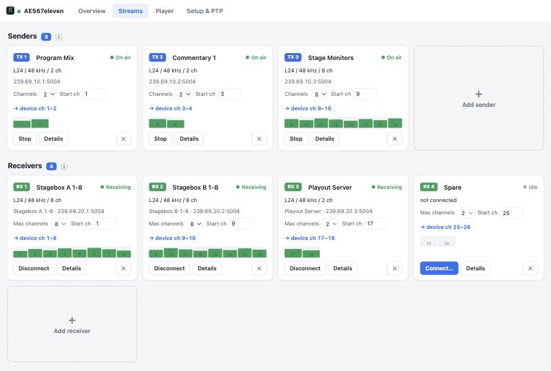
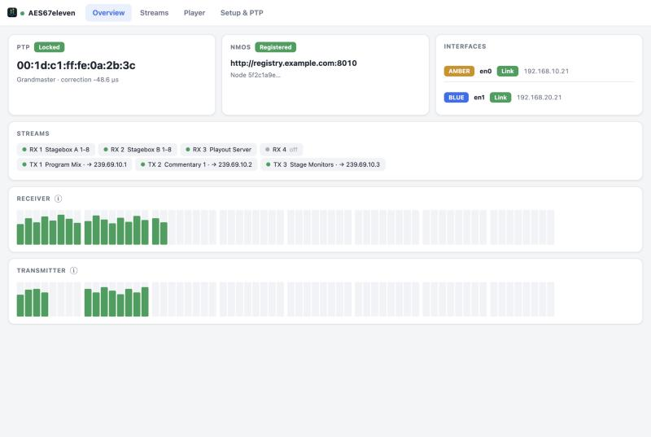

# AES67eleven

AES67 virtual soundcard for macOS with NMOS. 64 channels in and out, a device
clock locked to PTP, free and open source. The same engine runs headless on
Linux as a Docker gateway.

**[Homepage](https://gemini2350.github.io/aes67eleven/)** ·
**[Download for macOS](https://github.com/Gemini2350/aes67eleven/releases/latest)**

<p>
  
  
</p>

## Features

- **64 × 64 Core Audio device** at 48 kHz. The clock follows the PTP
  grandmaster, so there is no sample-rate conversion in the audio path.
- **Up to 64 senders and 64 receivers**, up to 8 channels each (L24 or L16,
  1 ms), placed anywhere on the device channels.
- **ST 2022-7** seamless redundancy on two interfaces.
- **NMOS**: IS-04, IS-05, IS-12, IS-13, BCP-008 sender and receiver monitors.
- **Web UI** with stream tiles, level meters and PTP status, plus a four-deck
  WAV/MP3 player and a local monitor output.
- **Linux / Docker gateway** for amd64 and arm64.

## Install on macOS

1. Download the installer from the
   [latest release](https://github.com/Gemini2350/aes67eleven/releases/latest)
   and double-click it. It needs macOS 13 or later and runs on Apple Silicon
   and Intel.
2. Allow **Local Network** when macOS asks. Without it no multicast arrives.
3. Open `http://localhost:8180`, or use the menu bar icon.
4. Select **AES67eleven** as the audio device in your app.

Use wired Ethernet: PTP does not work over Wi-Fi. Installing restarts Core
Audio, which interrupts all system audio for a moment.

To uninstall, run `bash /usr/local/share/aes67-vsc/uninstall.sh`.

To build from source instead (Xcode Command Line Tools and CMake):

```bash
./scripts/install.sh
```

## Linux / Docker gateway

A headless playout and monitoring node without a soundcard.

```bash
docker run -d --name aes67eleven \
  --network host --cap-add SYS_NICE \
  -v aes67-data:/data \
  gemini2350/aes67eleven-gw:latest
```

The image is also on `ghcr.io/gemini2350/aes67eleven-gw`, and
[`docker/docker-compose.yml`](docker/docker-compose.yml) has the same setup
for Compose.

- Host networking is required for multicast, PTP and DNS-SD.
- The config lives in the volume at `/data/config.json`. Start from
  [`docker/config.example.json`](docker/config.example.json) and give every
  host its own `uuid_seed`.
- Web UI on port 8180, NMOS Node API on port 8081.
- Prefer bare metal: PTP is less stable inside a VM.

## Where things are

| | macOS | Docker |
|---|---|---|
| Web UI | `http://localhost:8180` | `http://<host>:8180` |
| NMOS Node API | `http://<ip>:8081/x-nmos/node/v1.3/` | same |
| Config | `~/Library/Application Support/aes67-vsc/config.json` | `/data/config.json` |
| Log | `~/Library/Logs/aes67-vsc/daemon.log` | `docker logs aes67eleven` |

## Limitations

- 48 kHz only, and at most 8 channels per stream.
- No SAP. Streams are discovered through NMOS or connected by SDP.
- Software PTP without hardware timestamping.
- On macOS the daemon runs only while a user is logged in.

## More

- [Technical notes](TECHNICAL.md): architecture, stream API, packaging,
  conformance.
- [MoIP Tools](https://gemini2350.github.io/moip-tools/): more open tools for
  media over IP.
- Professional help with AES67, Dante, ST 2110, NMOS and PTP:
  [simplexity.ch](https://simplexity.ch).

## License

MIT, see [LICENSE](LICENSE). Bundled third-party components: civetweb (MIT),
nlohmann/json (MIT), dr_wav (public domain / MIT-0), minimp3 (CC0), libASPL
(MIT, fetched by CMake).
